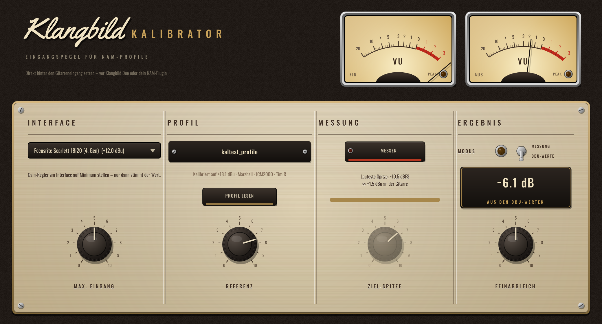

# Klangbild Kalibrator

Stellt den Eingangspegel so ein, dass deine Gitarre ein **NAM-Profil** genauso anfährt wie
die echte Gitarre den echten Amp bei der Aufnahme des Profils. Audio Unit für Logic Pro
(außerdem VST3 und Standalone), gebaut mit [JUCE](https://juce.com).



## Wozu?

Ein Amp reagiert auf die *Spannung* am Eingang. Dein Interface wandelt diese Spannung in
digitale Werte um – wie laut ein bestimmter Anschlag digital ankommt, hängt vom Interface ab.
Viele NAM-Profile speichern in ihren Metadaten (`input_level_dbu`), welchem analogen Pegel
0 dBFS bei der Aufnahme entsprach. Der Kalibrator gleicht beides ab:

**Verstärkung = max. Eingangspegel des Interfaces (dBu) − Referenz des Profils (dBu) + Feinabgleich**

Beispiel: Scarlett 18i20 (4. Gen, +12 dBu) und ein Profil, das auf +18,1 dBu kalibriert ist → **−6,1 dB**.

## Bedienung

1. **Interface** wählen (Voreinstellung: Focusrite Scarlett 18i20 4. Gen, +12 dBu) – oder den Wert
   von Hand einstellen. Wichtig: **Gain-Regler am Interface auf Minimum**, sonst stimmt der Wert nicht.
2. **Profil lesen**: die `.nam`-Datei wählen oder ins Fenster ziehen. Steht ein Pegel im Profil,
   wird die *Referenz* automatisch gesetzt. Fehlt er, stellst du sie von Hand ein (üblich: +12 dBu).
3. Fertig – das Ergebnis steht im schwarzen Feld. Mit **Feinabgleich** kannst du bewusst
   heißer oder sanfter in den Amp gehen.

**Messung (Alternative, wenn du keine dBu-Werte hast):** *Messen* drücken und 10 Sekunden so hart
spielen wie live. Im Modus **MESSUNG** werden deine lautesten Spitzen auf die **Ziel-Spitze**
(Standard −10 dBFS) gebracht. Die Messung zeigt außerdem, wie viel dBu deine Gitarre tatsächlich liefert.
Tipp: Die Spur in Logic muss dafür Signal durch das Plugin schicken (Spur auswählen bzw. Eingangsmonitoring an).

**VU-Meter:** EIN = Signal vom Interface, AUS = nach der Kalibrierung. Leuchtet die PEAK-Lampe
links rot, übersteuert schon der Interface-Eingang.

### Signalweg in Logic
Gitarrenspur → **Klangbild Kalibrator** → Klangbild Duo / NAM-Plugin (dort den Eingang auf 0 dB lassen)
→ ggf. IR → Klangbild Raum.

## Werte der Interface-Liste

Maximaler Pegel der Instrumenteneingänge bei **minimaler Verstärkung** laut Herstellerangaben
(zusammengetragen aus Handbüchern, der NAM-Dokumentation und Foren). Herstellerangaben können
vom tatsächlich gemessenen Wert etwas abweichen.

| Interface | dBu |
|---|---|
| Focusrite Scarlett 18i20 (4. Gen) | +12,0 |
| Focusrite Scarlett 18i20 / Scarlett (3. Gen) | +12,5 |
| Focusrite Scarlett (4. Gen) | +12,0 |
| Focusrite Scarlett 2i4 (2. Gen) | +13,0 |
| Audient iD4 / iD14 MKII | +12,0 |
| Universal Audio Apollo Twin X (Hi-Z) | +12,2 |
| Universal Audio Volt | +12,5 |
| Solid State Logic SSL 2 / 2+ | +15,0 |
| Arturia MiniFuse | +11,5 |
| Line 6 Helix (als Interface) | +11,5 |
| RME Babyface Pro / UCX II (Inst, 0 dB Gain) | +13,0 |
| IK Multimedia AXE I/O | +14,0 |
| Zoom Neurig | +12,4 |

## Installation in Logic Pro

Tab **Actions** → letzter grüner Lauf → **Artifacts** → `Klangbild-Kalibrator-macOS`, dann:

1. `Klangbild-Kalibrator-AU.zip` entpacken → `Klangbild Kalibrator.component`
2. Finder → ⇧⌘G → `~/Library/Audio/Plug-Ins/Components` → Datei hineinkopieren
3. Einmal im Terminal:
   ```
   xattr -dr com.apple.quarantine ~/Library/Audio/Plug-Ins/Components/"Klangbild Kalibrator.component"
   ```
4. Logic starten: **Audio Units → Klangbild → Klangbild Kalibrator**

## Lizenzen

Schriften *Oswald* (OFL 1.1) und *Yellowtail* (Apache 2.0) – Lizenztexte in `Resources/`.
JUCE: AGPLv3 bzw. kommerziell – für den privaten Gebrauch unproblematisch.
